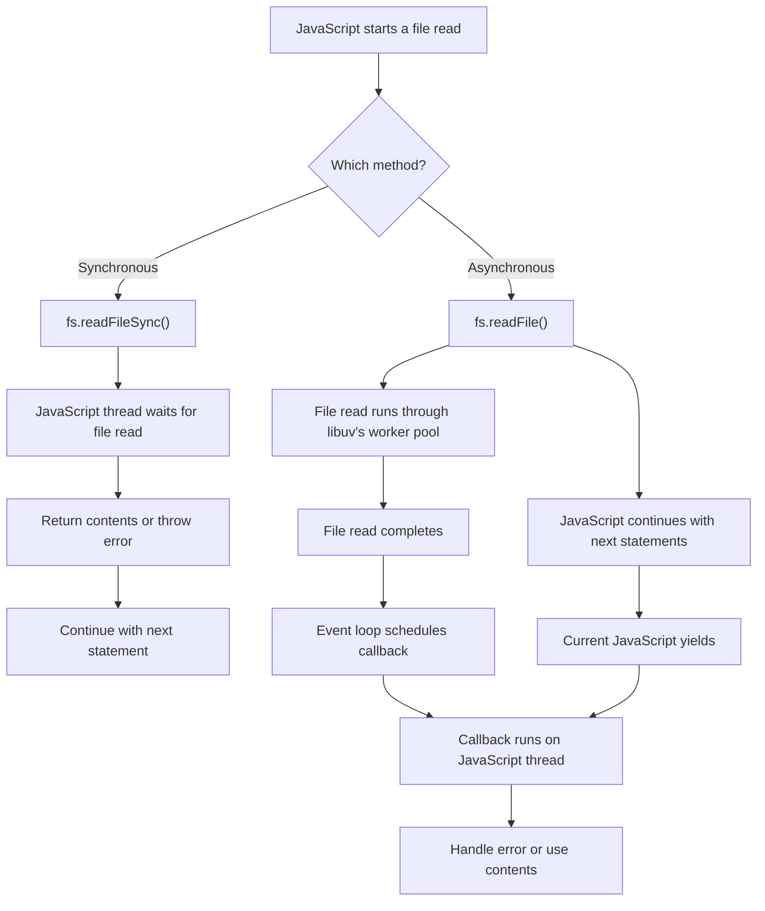

# File Handling in Node.js

Node.js provides the built-in `fs` (file system) module for working with files and directories. It can read, create, update, rename, and delete files.

`fs` is a Node.js core module, not an external npm package. You do not need to install it. In this folder, `file.js` loads it with CommonJS:

```javascript
const fs = require("fs");
```

In modern Node.js, the equivalent built-in module name can also be written with the `node:` prefix:

```javascript
const fs = require("node:fs");
```

## Reading a file

`fs.readFile()` reads a file asynchronously. Pass an encoding such as `"utf8"` to receive a string; without an encoding, the result is a `Buffer`.

```javascript
const fs = require("fs");

fs.readFile("notes.txt", "utf8", (error, content) => {
	if (error) {
		console.error("Could not read the file:", error);
		return;
	}

	console.log(content);
});
```

## Writing and appending

`fs.writeFile()` creates a file if it does not exist, and replaces its contents if it does. `fs.appendFile()` adds content to the end of a file, creating it if needed.

```javascript
const fs = require("fs");

fs.writeFile("notes.txt", "My first note\n", "utf8", (error) => {
	if (error) {
		console.error("Could not write the file:", error);
		return;
	}

	console.log("File written");
});
```

```javascript
fs.appendFile("notes.txt", "Another note\n", "utf8", (error) => {
	if (error) {
		console.error("Could not append to the file:", error);
		return;
	}

	console.log("Content appended");
});
```

## Promises and `async`/`await`

The `fs/promises` module provides promise-based versions of file operations. It is also built into Node.js:

```javascript
const fs = require("node:fs/promises");
const path = require("node:path");

async function main() {
	const filePath = path.join(__dirname, "notes.txt");

	try {
		await fs.writeFile(filePath, "My first note\n", "utf8");
		const content = await fs.readFile(filePath, "utf8");
		console.log(content);

		await fs.appendFile(filePath, "Another note\n", "utf8");
	} catch (error) {
		console.error("File operation failed:", error);
		process.exitCode = 1;
	}
}

main();
```

## Other common operations

These are asynchronous callback-based methods from `fs`:

```javascript
fs.rename("old-name.txt", "new-name.txt", (error) => {
	if (error) console.error("Could not rename the file:", error);
});

fs.unlink("new-name.txt", (error) => {
	if (error) console.error("Could not delete the file:", error);
});

fs.mkdir("my-folder", { recursive: true }, (error) => {
	if (error) console.error("Could not create the folder:", error);
});
```

`fs.unlink()` deletes a file. Use `fs.rmdir()` or `fs.rm()` for directories, depending on the operation and Node.js version; take care with recursive deletion because it can remove all contents.

## More `fs` functions

### `appendFileSync()` and `appendFile()`

Both functions add data to the end of a file and create the file if it does not exist. `appendFileSync()` blocks until the append finishes; `appendFile()` runs asynchronously and reports errors through its callback.

```javascript
fs.appendFileSync("./test.txt", "\nAdded by the synchronous method");

fs.appendFile("./test.txt", "\nAdded by the asynchronous method", "utf8", (error) => {
	if (error) {
		console.error("Could not append to the file:", error);
		return;
	}

	console.log("Content appended");
});
```

Neither method returns the appended file contents. The synchronous method returns `undefined`; the callback-based method provides its error through the callback.

### `cpSync()`

`fs.cpSync(source, destination)` copies a file. To copy a directory and its contents, pass `{ recursive: true }`. `cpSync()` is available in Node.js 16.7.0 and newer.

```javascript
fs.cpSync("./test.txt", "./test-copy.txt");
fs.cpSync("./source-folder", "./backup-folder", { recursive: true });
```

### `unlinkSync()`

`fs.unlinkSync(path)` deletes a file immediately and throws if the operation fails. It deletes files, not directories; use a directory-specific method for those. Check the path carefully before calling it because the deletion cannot be undone by this method.

```javascript
fs.unlinkSync("./test-copy.txt");
```

### `statSync()`

The method is named `statSync()`, not `statsSync()`. It returns a `Stats` object containing information about a file or directory. For example, `size` is measured in bytes, `mtime` is the last-modified date, and `isFile()`/`isDirectory()` identify the path type.

```javascript
const stats = fs.statSync("./test.txt");

console.log("Is file:", stats.isFile());
console.log("Size in bytes:", stats.size);
console.log("Last modified:", stats.mtime);
```

If the path does not exist or cannot be accessed, `statSync()` throws an error.

### `mkdirSync()`

The method is named `mkdirSync()`, not `mkdieSync()`. It creates a directory. Use `{ recursive: true }` to create missing parent directories as well.

```javascript
fs.mkdirSync("./data/notes", { recursive: true });
```

These `Sync` methods block Node.js until the operation completes and throw errors on failure. In application code, handle those errors with `try`/`catch`; use asynchronous alternatives when blocking would interfere with other work.

## Paths and error handling

Relative paths such as `"notes.txt"` are resolved from the process's current working directory, which depends on where Node.js was started. To build a path relative to the current JavaScript file, use `path.join(__dirname, "notes.txt")`.

File operations can fail—for example, a file may not exist or the process may not have permission to access it. Handle the error callback or catch a rejected promise rather than assuming an operation succeeded.

## Synchronous methods

The `fs` module also has synchronous methods, such as `fs.readFileSync()` and `fs.writeFileSync()`. They block the Node.js event loop until the operation finishes, so asynchronous or promise-based methods are generally preferable in application code. Synchronous methods can be useful for short scripts or startup tasks.

## `writeFile()` and `writeFileSync()` in this folder

The `file.js` example demonstrates both ways to write a file:

```javascript
const fs = require("fs");

fs.writeFileSync(
	"./testSync.txt",
	"This is created using fs package by Synchronous method"
);

fs.writeFile(
	"./testAsync.txt",
	"This is created using fs package by Asynchronous method",
	(error) => {
		if (error) {
			console.error("Could not write file:", error);
			return;
		}

		console.log("Async file written");
	}
);
```

`fs.writeFile(path, data, callback)` writes asynchronously: Node.js can continue running other code while the file is being written, and the callback runs when the operation finishes. If the file does not exist, it is created; if it already exists, its contents are replaced. When `data` is a string, it is encoded as UTF-8 by default. You can provide an encoding explicitly, for example `"utf8"`, before the callback.

The callback receives an error as its first argument. Check it and report or handle the failure. In the current `file.js`, the error check and success message are commented out, so a failed write would not be reported.

`fs.writeFileSync(path, data)` also creates or replaces the file, but blocks the Node.js event loop until the write completes. Prefer `fs.writeFile()` in most application code so other work is not blocked.

| Difference | `fs.writeFile()` | `fs.writeFileSync()` |
| --- | --- | --- |
| Execution | Asynchronous; Node.js can continue other work while writing | Synchronous; Node.js waits for the write to finish |
| Completion | Reports completion through a callback | Returns only after the operation finishes |
| Error handling | Check the callback's `error` argument | Throws an error; use `try`/`catch` if it needs to be handled |
| Best suited for | Most application code, especially servers handling multiple tasks | Short scripts or startup tasks where blocking is acceptable |
| Return value | `undefined` in the callback-based form | `undefined` |

Neither callback-based `fs.writeFile()` nor `fs.writeFileSync()` returns the file contents; both return `undefined`. Do not assign their return values expecting to export the data. If you need to use the written content later, read the file with `fs.readFile()` or `fs.readFileSync()`.

These methods write files; they do not watch them. `fs.watchFile()` is a separate API for monitoring file changes and does not accept file content as an argument.

## Reading files synchronously and asynchronously

The current `file.js` reads `test.txt` in two ways. A synchronous read returns the contents directly:

```javascript
exports.readData1 = fs.readFileSync("./test.txt", "utf-8");
```

`fs.readFileSync(path, encoding)` blocks execution until the file has been read. With `"utf-8"` as the encoding, the returned value is a string, which this example stores as the module's `readData1` export. Without an encoding, the method returns a `Buffer`. If the file cannot be read, `readFileSync()` throws an error; handle it with `try`/`catch` if the program should recover.

The asynchronous version uses a callback:

```javascript
fs.readFile("./test.txt", "utf-8", (err, result) => {
	if (err) {
		console.log("Error", err);
	} else {
		console.log(result);
	}
});
```

`fs.readFile(path, encoding, callback)` lets Node.js continue running other code while it reads. When the read finishes, Node.js calls the callback with an error as the first argument and the file contents as the second. If there is an error, the content is unavailable, so check the error before using the content. The callback-based method does not return the contents directly; use the callback argument as shown.

| Difference | `fs.readFile()` | `fs.readFileSync()` |
| --- | --- | --- |
| Execution | Asynchronous; other code can run while reading | Synchronous; blocks until the read finishes |
| Where the contents are received | In the callback's second argument | As the method's return value |
| Error handling | Check the callback's first argument | Throws an error; use `try`/`catch` |
| Best suited for | Most application code | Short scripts or startup tasks where blocking is acceptable |

## How `App.js` loads `file.js`

`App.js` uses `require("./file")` to load the neighboring `file.js` module. Requiring it executes its top-level code: it writes `testSync.txt`, starts writing `testAsync.txt`, reads `test.txt` synchronously, starts an asynchronous read of `test.txt`, and then appends `"\n6. Sagar"` to `test.txt` synchronously. These relative paths are resolved from the process's current working directory.

The synchronous read is exported as `readData1` and captures the contents before the append. After `require("./file")` finishes, `App.js` logs that string with `console.log(fs.readData1)`. The asynchronous read does not export its result; its callback logs the content later. Since the asynchronous read and synchronous append are started close together, whether that callback sees the appended text depends on when the read actually happens. The append operation is assigned to `exports.appendData`, but the method returns `undefined`, not the updated file contents. If `test.txt` is missing or cannot be read, the synchronous read throws before the asynchronous read or append is started.

## How Node.js works: synchronous, asynchronous, blocking, and non-blocking

Node.js runs JavaScript outside the browser using the V8 JavaScript engine. In a typical Node.js program, JavaScript runs on one main thread. Node.js also uses the operating system and a library called libuv to handle operations such as file access and networking.

The **event loop** coordinates when JavaScript callbacks can run. For example, an asynchronous file read is started, and Node.js can run other JavaScript while the file is being read. When the read finishes, its callback can run once the current JavaScript work has yielded. Most asynchronous file-system operations use libuv's worker thread pool; network I/O generally uses operating-system mechanisms instead. Callbacks themselves run on the JavaScript thread, not in the file-system worker thread.

### File-read flow diagram

The diagram compares the two file-read examples below. In the asynchronous path, the file read and subsequent JavaScript can proceed concurrently; the callback runs only after the read completes and JavaScript is available to run it.



### Synchronous and blocking

**Synchronous** code completes an operation before proceeding to the next statement. A **blocking** operation prevents the JavaScript thread from doing other work while it waits. Synchronous file I/O is blocking:

```javascript
const fs = require("fs");

console.log("Start");
try {
	const content = fs.readFileSync(__filename, "utf8");
	console.log("File read:", content.length, "characters");
} catch (error) {
	console.error("Could not read the file:", error);
}
console.log("End");
```

`__filename` is the path to the current CommonJS file. On success, the output order is `Start`, `File read: ...`, then `End`: the read finishes before the next statement runs.

### Asynchronous and non-blocking

**Asynchronous** operations let the program receive a result later, typically through a callback or a promise. **Non-blocking** I/O lets the JavaScript thread continue while it waits for the operation:

```javascript
const fs = require("fs");

console.log("Start");
fs.readFile(__filename, "utf8", (error, content) => {
	if (error) {
		console.error("Could not read the file:", error);
		return;
	}

	console.log("File read:", content.length, "characters");
});
console.log("End");
```

On success, the output order is `Start`, `End`, then `File read: ...`. The callback runs later, after the current JavaScript finishes and the read completes. Use the result inside the callback, or use `fs/promises` and `await` when subsequent work depends on it.

| Term | Meaning | Example |
| --- | --- | --- |
| Synchronous | The operation completes before the next statement runs | `fs.readFileSync()` |
| Asynchronous | The result is made available later | `fs.readFile()` with a callback |
| Blocking | The JavaScript thread cannot do other work during the operation | Waiting for `fs.readFileSync()` |
| Non-blocking | The JavaScript thread can do other work while waiting for I/O | Starting `fs.readFile()` |

These terms are related but describe different things: synchronous/asynchronous describe **when a result is available**, while blocking/non-blocking describe **whether the thread can make progress while waiting**. An asynchronous callback can still block the event loop if it runs a long calculation. For CPU-intensive work, consider worker threads rather than running the calculation on the main JavaScript thread.

### Why prefer non-blocking I/O?

While a non-blocking file read is in progress, Node.js can handle other requests, run callbacks, or start more I/O instead of making the JavaScript thread wait for the file. This helps applications such as web servers stay responsive when many operations are in progress. It does not necessarily make one file read faster, and long-running JavaScript can still block the event loop.

Synchronous methods can still be useful in short scripts or during startup, when simplicity matters and blocking is acceptable. For asynchronous work that must happen in order, use callbacks or `async`/`await`; starting operations asynchronously does not guarantee their completion order.

### The libuv thread pool

By default, libuv's worker thread pool has **4 threads**. Many asynchronous file-system operations use this pool, as do certain other operations such as `crypto.pbkdf2()`, zlib operations, and `dns.lookup()`. Work can wait in a queue when the pool is busy. This is separate from the main JavaScript thread: it does not mean Node.js runs four JavaScript callbacks at once.

You can change the pool size with the `UV_THREADPOOL_SIZE` environment variable **before starting Node.js**. For example, in PowerShell:

```powershell
$env:UV_THREADPOOL_SIZE = "8"
node App.js
```

This sets the pool size for Node.js processes started from that PowerShell session. It does not change the default permanently. Set it before launching Node.js rather than relying on changing `process.env.UV_THREADPOOL_SIZE` in your program, because the pool may already have been initialized.

Increasing the pool size may help when many pool-backed operations are waiting, but it can also increase resource use and contention. Measure your application before changing it. The pool is shared across event loops in the process, and increasing it does not add JavaScript execution threads or generally speed up network I/O; use worker threads for CPU-intensive JavaScript.